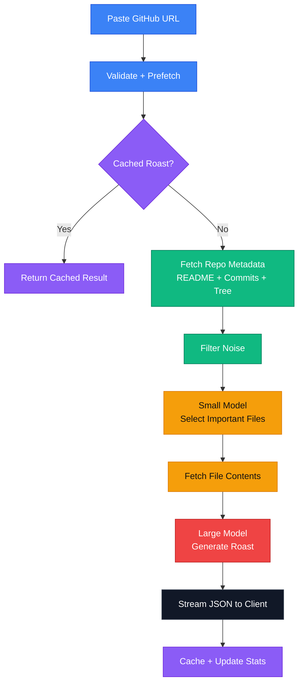

# RepoRoast

A fork RepoRoast to be more brutal and specific. CLI only for customization and use inside of a coding agent with or without an API key. as a fun little weekend project that takes any public GitHub repository and returns a brutally honest roast.

It is built to feel fast, merciless, and a little unhinged on purpose. The project focuses on good UX flow, efficient LLM usage, caching, and a visual style with attention to detail that does not look like vibe coded slop.

## How it works

1. A user pastes a GitHub repo URL.
2. The client prefetches repo data in the background as soon as the URL looks valid.
3. The app checks whether a roast already exists in cache.
4. If not, it fetches repository metadata, README content, commit messages, and a filtered file tree.
5. The coding agent reads that summary in the CLI and writes the roast, following the rules in `server/prompts.js`.
6. The server stores cached roasts and exposes the count and recent list.

Roast generation is CLI-only. The server no longer calls an LLM provider; the coding agent does the work, and the old `/roast` and `/pick-files` endpoints return `410 Gone` with that explanation.

## Tone

Every roast has two modes. The default, Full Filth, is deliberately obscene: at least one real swear per paragraph, no asterisks, no euphemisms, and a verdict with teeth. Clean Mode keeps the same 12-paragraph structure and the same brutality without a single curse word. Both modes ban slurs, sexual content, threats, attacks on protected characteristics, taking the Lord's name in vain, and references to mental illness or DSM diagnoses (such as schizophrenia, autism, depression, psychosis, or intellectual disability), because being vile about code is the point and being vile about people, faith, or health is not.

## Tech Stack

### Frontend

- Next.js
- TypeScript
- Tailwind CSS
- Radix UI / shadcn components
- lucide-react icons
- facehash for generated avatars

### Backend

- Express
- Upstash Redis for caching

## Architecture

RepoRoast uses a two-stage LLM pipeline so it can stay responsive and avoid sending unnecessary context to the larger model.

The repo tree can be huge, but most files are irrelevant to understanding the project. RepoRoast first uses a smaller fast model to choose the most useful files, then only sends those files plus compact repo metadata to the larger model.

That keeps the prompt smaller, the response faster, and the output more grounded.

## Caching And Performance

RepoRoast uses several layers of caching and prefetching:

- Client-side prefetching warms the repo summary before navigation.
- Server-side roast caching avoids regenerating the same result.
- GitHub repo existence checks are cached briefly in memory.
- Upstash Redis stores the roast cache, total roast count, and recent roasts.
- The file tree pipeline filters noise before asking the smaller model for file selection.

This combination is what makes the app feel fast even though it is doing multiple network calls.

## Things I Learned Or Found

- How to optimize sending things to an LLM
- Lucide animated icons
- Prefetching repo data + LLM call before the user even presses the roast button making it feel a lot more snappy
- Game of Life in the footer: [credits](https://www.agastyasharma.dev/)
- A nice avatar library: [facehash](https://www.facehash.dev/)
- Prompt engineering
- Being able to stream JSON and parse on the fly

Thank you for reaching this far \:)
